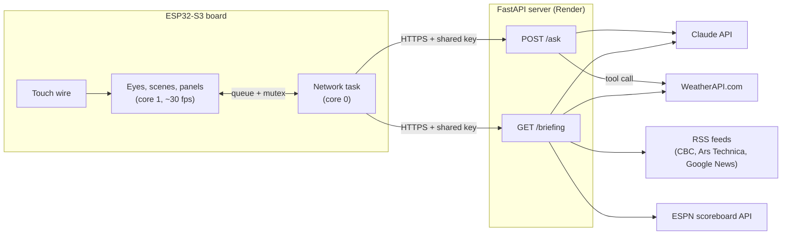

# Steve, a desk pet

Steve is a small robot that lives on my desk: a pair of animated eyes on a 2.8" screen, driven by an ESP32-S3, with a Python server and Claude behind him. He's built to be glanced at, not read. Ask him something and he answers with a face, a little weather scene and a few words. On weekday mornings he reads the paper until I tap him, then plays a briefing of the weather, my teams and the news. At night he gets sleepy, yawns and switches his screen off.


## What he does

- **Animated eyes** that blink, glance around and morph between expressions: happy, sad, sleepy, suspicious, angry and a scanning "thinking" look.
- **Glanceable answers.** Type a question and he shows a reaction, a headline of 30 characters or fewer and, for weather, an animated scene (sun, cloud, rain under an umbrella, snow with a snowman, fog, a thunderstorm).
- **Live weather** through a tool that Claude decides when to call.
- **Weekday morning briefing.** He fetches it at 8:50, reads a newspaper from 9:00 until I tap a touch wire, then plays it as cards: a greeting, the day's weather, a panel for each of my teams (next game, standing, top headline), and Canada, tech and world news. Panels slide in with topic colours, icons and progress dots. If I never tap, he forgets about it at noon.
- **Sleep.** Drowsy and yawning from 10:30 PM, asleep with the backlight off from 11, awake again at 7:30. A tap at night shows him sleeping, a second one wakes him grumpily, and a question wakes him properly, answers, then lets him drift back off.

## How it works



The board never holds an API key. It sends a question, or asks for the briefing, to my own server, which checks a shared key, gathers data, calls Claude and sends back a small JSON object. Keeping the brain on the server means prompts and data sources change without reflashing the board.

A few design decisions:

- **Code decides the structure, Claude writes the words.** The server picks which briefing cards exist and in what order, and Claude only fills in the text. Structured output (Pydantic models) guarantees the shape, and the server still checks the content: lengths, screen-safe characters, cards that came back missing.
- **Nothing on the board blocks.** Networking runs in its own FreeRTOS task on the second core, handing results back through a queue and a mutex-guarded struct with a version counter. The animation loop never waits on Wi-Fi.
- **Only changed pixels move.** The frame is drawn into a sprite in PSRAM, and only the regions that changed (the face, a scene, a panel) are pushed over SPI.
- **One thing moves the face at a time.** Sleep, the morning routine, the briefing player and answers each hand the face over at safe points instead of fighting over it.

## Hardware

- Freenove ESP32-S3 2.8" display board (FNK0104, the non-touch version): an ESP32-S3 with PSRAM and 16 MB of flash, and an ILI9341 320×240 screen. [LCDwiki page](https://www.lcdwiki.com/2.8inch_ESP32-S3_Display).
- A jumper wire on GPIO 14 as a capacitive touch pad.

## Tech stack

| Part | Tools |
|---|---|
| Firmware | C++, Arduino core on ESP32-S3, PlatformIO, FreeRTOS, TFT_eSPI, ArduinoJson |
| Server | Python, FastAPI, Pydantic, httpx, the Anthropic SDK |
| Hosting | Render |
| Data | WeatherAPI.com, RSS feeds, ESPN's public scoreboard endpoints |

## Repository layout

```
firmware/          PlatformIO project for the board
  src/             eyes, scenes, headline, briefing panels and player,
                   morning scheduler, reading look, sleep, network, touch
  include/         headers, plus secrets.example.h
  lib/             TFT_eSPI and the board's display setup
server/            FastAPI app: /ask, /briefing, weather, news, sports
tools/             make_team_icons.py (turns local PNGs into an icon header)
docs/LEARNINGS.md  what I learned in each phase, problems and fixes included
```

## Running it yourself

### Server

```bash
cd server
python -m venv .venv
.venv\Scripts\activate          # Windows; on macOS/Linux: source .venv/bin/activate
python -m pip install -r requirements.txt
cp .env.example .env            # then fill in the three keys
uvicorn main:app --host 0.0.0.0 --port 8000
```

`.env` needs an Anthropic API key, a WeatherAPI.com key, and `STEVE_KEY`, a long random string the board sends with every request. The server refuses to start without them. `http://localhost:8000/docs` lets you try both endpoints.

### Firmware

1. Open `firmware/` in VS Code with the PlatformIO extension.
2. Copy `include/secrets.example.h` to `include/secrets.h` and fill in your Wi-Fi details, the server's base address (no trailing path) and the same `STEVE_KEY`. `secrets.h` is gitignored.
3. Build and upload, then open the serial monitor at 115200 baud.

Anything typed in the serial monitor goes to Steve as a question. Lines starting with `/` are test commands, for example `/brief`, `/play`, `/morning`, `/read`, `/sleep`, `/wake`, `/auto` and `/time`, and scene names like `/rain` or `/storm`.

### Team icons (optional)

The team panels draw simple icons by default. To use your own images, put square PNGs named after the card id (`leafs.png`, `saints.png`) in `firmware/icons/` and run `python tools/make_team_icons.py`. Both the images and the generated header are gitignored, so they stay on your machine.

## Roadmap

Done:

- Animated eyes and expressions
- Wi-Fi, time and the dual-core network task
- The server and Claude, deployed to Render
- Glanceable replies with headlines
- Weather tool and weather scenes
- Weekday morning briefing with the reading look
- Sleep mode

Next:

- Focus timer and timers
- Spotify, with reactions to the music
- Live scores, with celebrations
- Voice input
- Rivers and fishing conditions
- Personality and polish

## What I learned

[docs/LEARNINGS.md](docs/LEARNINGS.md) is a running log of each phase: the concepts, the bugs, and how they were fixed. A few favourites:

- A `uint16_t` timeout parameter quietly turned 120 seconds into 54.
- An endpoint's return type silently filtered out new response fields.
- A name lookup that only fails at runtime took down every `/ask` after a rename, which a linter would have caught in a second.
- Lid shapes always read as some emotion, so the thinking face had to be shown through motion instead.

## Acknowledgements

- [TFT_eSPI](https://github.com/Bodmer/TFT_eSPI) by Bodmer, included in `firmware/lib` with Freenove's setup files for this board.
- [ArduinoJson](https://arduinojson.org/) by Benoit Blanchon.
- Weather from [WeatherAPI.com](https://www.weatherapi.com/), news from public RSS feeds, scores from ESPN's public endpoints. Not affiliated with any of them, or with the teams Steve follows.
